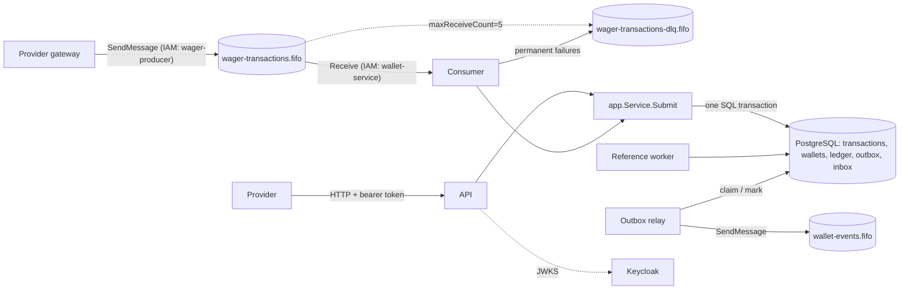

# Architecture

This document records the decisions behind the wallet service: how money is represented, where each guarantee is enforced, how the instances coordinate, and what was left out. [README.md](README.md) covers running and testing.

## Contents

1. [Overview](#overview)
2. [Money](#money)
3. [Domain model](#domain-model)
4. [Transaction state machine](#transaction-state-machine)
5. [Operations, references and reversals](#operations-references-and-reversals)
6. [Persistence and SQL transactions](#persistence-and-sql-transactions)
7. [Concurrency control](#concurrency-control)
8. [Invariants enforced by the database](#invariants-enforced-by-the-database)
9. [Idempotency](#idempotency)
10. [Pending references](#pending-references)
11. [SQS consumer](#sqs-consumer)
12. [Transactional outbox](#transactional-outbox)
13. [Event contracts](#event-contracts)
14. [Authentication and authorization](#authentication-and-authorization)
15. [Composition and lifecycle with Fx](#composition-and-lifecycle-with-fx)
16. [Failure handling summary](#failure-handling-summary)
17. [Observability](#observability)
18. [Interpretations, limitations and unfinished work](#interpretations-limitations-and-unfinished-work)

## Overview



Every instance runs the same binary: the HTTP API, the SQS consumer, the outbox relay and the pending-reference worker. Instances share nothing but PostgreSQL, SQS and Keycloak; no correctness property depends on how many there are or which one handles a request.

Dependencies point inwards. They are listed outermost first:

- `cmd/wallet`, which runs the application, and `internal/bootstrap`, the composition root; only these two know Uber Fx
- adapters: `httpapi`, `messaging`, `postgres`, `outbox`, `auth`, `worker`, `config`
- `internal/app` (use cases and persistence ports)
- `internal/domain`
- `internal/money`

`internal/observability` (logger fields and Prometheus metrics) is a leaf package that every layer above the domain may use; `internal/app` records its metrics through it. The domain imports no framework, transport or database library.

## Money

`money.Money` is an immutable value object: an `int64` count of **minor units** (cents) plus a `Currency`.

- **Scale:** fixed at two decimals. The supported currencies are the ISO 4217 codes with a two-decimal minor unit: BRL, USD, EUR and GBP. Codes with a different exponent (JPY, KWD, …) are rejected rather than mis-scaled. Arithmetic and comparison across currencies fail with `ErrCurrencyMismatch`.
- **Range:** −92,233,720,368,547,758.08 to 92,233,720,368,547,758.07. Parsing, `Add`, `Sub` and `Negate` detect overflow (`ErrOverflow`) instead of wrapping. A credit that would overflow a balance is rejected with `BALANCE_LIMIT_EXCEEDED`.
- **Parsing:** only the canonical form `-?(0|[1-9][0-9]*)\.[0-9]{2}` is accepted. Empty strings, `NaN`, `Infinity`, exponents, `+`, whitespace, other separators, missing or extra fraction digits, leading zeros and `-0.00` are rejected, never normalized or rounded. External inputs must also be non-negative. Every accepted amount therefore has exactly one spelling, which keeps the idempotency fingerprint free of normalization rules.
- **No floating point anywhere:**
  - parsing works on the decimal digits (`strconv.ParseInt` on the digits without the point);
  - formatting divides integers;
  - JSON carries amounts as strings, and a JSON number fails to decode into the request DTOs;
  - PostgreSQL stores `BIGINT` minor units next to a `currency` column;
  - ledger sums are cast `numeric → bigint`, which fails loudly instead of overflowing.
- **Zero value:** the zero `Money{}` is invalid and every operation on it fails with `ErrUninitialized`. Negative amounts exist only for internal differences, such as the reconciliation `difference`, never in balances.

## Domain model

| Type | Responsibility |
| --- | --- |
| `Wallet` | Aggregate root, the only place a balance changes. `Debit`/`Credit` validate the amount and currency, refuse to go negative, increment the version by one and return the `LedgerEntry` of the movement. `OpenWallet` creates version 1, crediting a positive initial balance through an internal OPENING transaction without bumping the version. |
| `WagerTransaction` | One operation and its processing state. External operations carry provider metadata; OPENING carries none. Transitions are explicit methods validated by the state machine below. |
| `LedgerEntry` | Immutable movement record. Construction validates `balanceAfter = balanceBefore ± amount` by direction, a positive amount and non-negative balances. |
| `TransactionRequest`, `WalletOpeningRequest` | Validated commands built from raw HTTP or SQS fields by one constructor, so both channels share validation, normalization and the idempotency fingerprint. All invalid fields are reported at once. |
| Events | `WagerTransactionProcessed`, `WagerTransactionRejected`, `WagerTransactionPendingReference`, `WalletBalanceChanged`: typed structs whose type name and schema version are fixed by the Go type. |

- **Creation vs rehydration:** `OpenWallet`/`NewExternalTransaction` create; `RehydrateWallet`/`RehydrateTransaction`/`RehydrateLedgerEntry` restore. Rehydration validates the stored state, rejecting states that can never be persisted (such as a PENDING row or a REJECTED row without its failure code). It never replays movements, transitions or events.
- **Events** are recorded by the state-changing methods and pulled by the use case into the outbox of the same SQL transaction.
- **Uninitialized values:** identifiers are structs with unexported fields whose zero value is invalid (`WalletID{}`, `ProviderID{}`, …). Constructors reject them. UUIDs are accepted only in their canonical 36-character form, in either case, and normalized to lower case.
- **Errors:** errors are classified with `errors.Is`/`errors.As`:
  - sentinel errors (`ErrInsufficientFunds`, `ErrInvalidTransition`, `ErrIdempotencyKeyReused`, …);
  - `*ValidationError` listing `FieldProblem`s with stable codes;
  - `FailureCode` for persisted rejections.

  Business refusals are values, never panics. Every I/O method takes a `context.Context`. Request, message and worker contexts carry deadlines, and pgx and the AWS SDK honour cancellation.

## Transaction state machine

```text
                ┌──────────────► PROCESSED   (terminal)
                │
   PENDING ─────┼──────────────► REJECTED    (terminal, failureCode)
  (memory only) │
                ├──────────────► FAILED      (terminal, PROCESSING_FAILED)
                │
                └──► PENDING_REFERENCE ──┬──► PENDING_REFERENCE  (retry scheduled, attempts+1)
                                         ├──► PROCESSED
                                         ├──► REJECTED
                                         └──► FAILED
```

- **`PENDING` is never persisted.** An operation is settled in the same SQL transaction that records it: the challenge allows synchronous completion without an intermediate acceptance commit. So the only persisted non-terminal state is `PENDING_REFERENCE`, and the reference worker always resumes it. The table's `status` CHECK does not even allow `PENDING`, which makes "every committed PENDING has a durable resumption" true by construction. A crash before the commit leaves nothing behind: the client or the queue retries with the same key and the operation is settled then.
- **Terminal states never change.** The domain refuses any transition from them (`ErrInvalidTransition`), and a database trigger refuses any update of a terminal row, or of any business column of any row.
- **Replays read the stored outcome** (status, failure code, balance) and never re-apply anything.
- **Transient vs permanent failures:** see [Failure handling summary](#failure-handling-summary). Only failures caused by the operation's own data become `FAILED`. Infrastructure problems are retried, never recorded.

## Operations, references and reversals

| Kind | Movement | Amount | Reference |
| --- | --- | --- | --- |
| `BET` | debit | > 0 | not allowed |
| `WIN` | credit | > 0 | optional: a BET of the same round |
| `LOSS` | none (no ledger entry, no version change) | exactly `0.00` | not allowed |
| `REFUND` | credit | equal to the BET | required: a BET |
| `ROLLBACK` | opposite of the target | equal to the target | required: a BET, WIN or REFUND |
| `OPENING` | credit | > 0 (zero openings create no transaction) | internal only; refused over HTTP and SQS |

References are resolved by `(providerId, referenceExternalTransactionId)`. A found reference must have an allowed kind and must match the operation on provider, wallet, player, currency and round; a reversal must also match its amount. These immutable properties are checked first, so a mismatch is rejected at once even if the reference is itself still pending. Then the reference's status decides:

1. still pending → keep waiting;
2. rejected or failed → `REFERENCE_NOT_PROCESSED`;
3. already reversed → `REFERENCE_ALREADY_REVERSED`.

**Combining REFUND and ROLLBACK.** A transaction can be reversed successfully at most once, by either a REFUND or a ROLLBACK, never both. A partial unique index enforces it in the database: `(reference_transaction_id) WHERE kind IN ('REFUND','ROLLBACK') AND status = 'PROCESSED'`. Under that rule:

- REFUND after ROLLBACK, ROLLBACK after REFUND, or a second REFUND or ROLLBACK of the same BET are rejected with `REFERENCE_ALREADY_REVERSED`, so a debit is never returned twice.
- A REFUND itself can be rolled back (ROLLBACK targets the REFUND). That debits the refunded amount again, and the BET stands, since it already had its one reversal.
- A WIN cannot settle a BET that was already reversed.

The reversal check and the unique index serialize on the wallet lock, so concurrent reversals of the same BET cannot both succeed. `TestRefundAndRollbackCannotReturnTheSameDebitTwice` races them.

**Reversal without funds.** A ROLLBACK of a WIN or REFUND that would take the balance below zero is rejected with `INSUFFICIENT_FUNDS_FOR_REVERSAL`. That code is distinct from a BET's `INSUFFICIENT_FUNDS`, and the rejection is recorded with its own event, so it stays auditable.

**What is recorded.**

- **Not recorded:** requests that fail stateless validation (`400`), authentication (`401`) or authorization (`403`), or that name an unknown wallet (`404`). Nothing is stored, so the same key can be reused after fixing the request.
- **Recorded:** everything decided against stored state. Rejections are kept as `REJECTED` with a stable `failureCode` and a `failureClass`:
  - `CORRECTABLE`: the request contradicts the stored state (player, currency, reference). The provider fixes it and submits a new operation.
  - `DEFINITIVE`: the outcome is final.

  Recording correctable rejections keeps every provider transaction id bound to exactly one answer.

## Persistence and SQL transactions

**Library:** `pgx/v5` with explicit SQL, no ORM, so transactions, locks and constraints stay visible in `internal/postgres`. Migrations use `golang-migrate`, embedded in `cmd/migrate`. Each file runs as one implicit transaction, and an advisory lock serializes concurrent migrators.

**Money mapping:** `amount_minor`, `balance_minor`, `balance_before_minor`, `balance_after_minor` and `result_balance_minor` are `BIGINT` columns, each beside a `currency TEXT` column with a CHECK on its format. Money is rebuilt with `money.New(minorUnits, currency)`, so storage and memory hold exactly the same value.

**Unit of work:** `app.Store.InTx(ctx, fn)` opens one `READ COMMITTED` transaction and passes `fn` an `app.Tx`. Its repositories — `Wallets()`, `Transactions()`, `Ledger()`, `Outbox()` and `Inbox()` — are all bound to that same `pgx.Tx`. That function call is the transaction boundary: everything the use case writes inside `fn` commits or rolls back together. Reads outside any unit of work go through `Store.Reader()`; the reconciliation read runs in its own `REPEATABLE READ READ ONLY` transaction, so the balance and the ledger sums come from one snapshot.

**Write order of a settlement**, inside one unit of work:

1. lock the wallet row;
2. insert (or update) the transaction with its final status;
3. update the wallet balance and version, version-checked;
4. append the ledger entry, which the database checks against steps 2 and 3;
5. append the outbox events;
6. insert the inbox record for SQS.

The commit runs the deferred checks.

**Retries:** units of work lost to a deadlock (`40P01`), a serialization failure (`40001`) or a stale version are retried from scratch, up to 3 times. `fn` rebuilds all its state on every call. Everything else is classified by `postgres.dbError`; see [Failure handling summary](#failure-handling-summary).

**Session limits:** each connection runs with `lock_timeout` (5 s), `statement_timeout` (15 s) and `idle_in_transaction_session_timeout` (30 s). A stuck lock becomes a transient `503` instead of a hang, and a crashed handler's transaction cannot hold locks forever.

## Concurrency control

Coordination is **per wallet**: pessimistic locking, plus an optimistic check as a backstop, plus database constraints as the final authority.

1. **Row lock.** Every writer of a wallet starts with `SELECT … FROM wallets WHERE id = $1 FOR NO KEY UPDATE`. Writers of the same wallet are serialized. Writers of other wallets never touch that row, so independent wallets run in parallel; there is no global or table lock anywhere. `FOR NO KEY UPDATE` excludes other writers exactly like `FOR UPDATE`, but it does not block the `KEY SHARE` locks that foreign-key checks take when rows referencing the wallet are inserted.
2. **Version check.** The balance update is `UPDATE … WHERE id = $1 AND version = $previous`. A writer that somehow skipped the lock could still never overwrite a committed update: it would affect zero rows, get `ErrStaleVersion`, and retry.
3. **Database invariants** (next section) hold even against code that bypasses both.

**Why pessimistic.** Wagering traffic is concentrated: one player's bets, wins and reversals hit the same wallet back to back. With optimistic retries, hot wallets would spin and burn retries under contention. With a short row lock they simply queue, each transaction holding it for about a millisecond. The race tests show the effect: one winner, one `INSUFFICIENT_FUNDS`, never a negative balance or a lost update.

**Deadlock freedom.** Lock order is fixed:

- The submit path locks one wallet and never waits on another row lock. Reference lookups are plain reads, and the foreign-key `KEY SHARE` it takes is compatible with `FOR NO KEY UPDATE`.
- The reference worker claims a pending transaction (`FOR NO KEY UPDATE SKIP LOCKED`), then locks its wallet.

No cycle can form. The retry on `40P01` remains as insurance.

**Proofs in the tests:**

- `TestTwoBetsRacingForTheSameBalanceOnDifferentInstances` and `TestTheSameBetFiftyTimesInParallelDebitsOnce` run across three processes.
- `TestIndependentWalletsDoNotWaitForEachOther` holds one wallet's row lock from a separate session: a bet on another wallet completes at once, while a bet on the locked wallet waits for the lock.

## Invariants enforced by the database

| Invariant | Mechanism |
| --- | --- |
| Balance never negative | `CHECK (balance_minor >= 0)`, plus non-negative CHECKs on every ledger balance |
| One wallet per player and currency | `UNIQUE (player_id, currency)` |
| Version starts at 1 and moves only with the balance, by exactly 1 | `BEFORE INSERT`/`BEFORE UPDATE` triggers (`WL007`) |
| Every balance change has its ledger entry | Deferred constraint trigger on `wallets`, checked at commit (`WL008`) |
| Every processed movement has its ledger entry | Deferred constraint trigger on `wagering_transactions` (`WL009`) |
| A ledger entry matches the wallet row, continues the wallet's chain, and belongs to a PROCESSED non-LOSS transaction with its amount and implied direction | `BEFORE INSERT` trigger on the ledger (`WL004`–`WL006`) and the arithmetic CHECK `balance_after = balance_before ± amount` |
| One ledger entry per transaction and per wallet version | `UNIQUE (wallet_id, transaction_id)`, `UNIQUE (wallet_id, wallet_version)` |
| The ledger is append-only | `UPDATE`/`DELETE`/`TRUNCATE` triggers (`WL003`); the service role has no such privilege |
| Terminal transactions and business fields never change; nothing is deleted | Triggers (`WL001`, `WL002`, `WL003`) |
| Persisted states are consistent (no PENDING; outcome fields per status; provider metadata only on external kinds; reference rules per kind; LOSS amount 0, others > 0) | Table CHECK constraints, written NULL-safe: a CHECK that evaluates to NULL passes |
| Idempotency: one transaction per provider key and per provider operation | `UNIQUE (provider_id, idempotency_key)`, `UNIQUE (provider_id, external_transaction_id)` |
| One OPENING per wallet; one successful reversal per transaction | Partial unique indexes |
| One inbox record per consumer and message | Primary key `(consumer_name, message_id)` |
| Outbox events are immutable snapshots; unpublished events cannot be deleted | Trigger (`WL002`, `WL003`) |
| The triggers cannot be fooled by a temporary table that shadows a table they read | Every trigger function pins `search_path = public, pg_temp`, and no role but the owner may create temporary tables (migration `000005`) |

**Privileges are part of the protection.** Migrations run as the owner. The service connects as `wallet_app`, which may `SELECT` and `INSERT` and may `UPDATE` only the columns its state machine moves (column-level grants). It cannot update or delete the ledger, delete anything, truncate, alter tables, disable the triggers or create temporary tables (`TestTemporaryTablesCannotShadowWhatTheTriggersCheck`). Triggers raise SQLSTATE class `WL`, so the service can tell invariant violations from transient errors.

`TestCorruptedBalanceIsCaughtByTheDatabaseAndByReconciliation` shows the layers together:

1. A superuser corrupts a balance with triggers disabled.
2. Reconciliation reports the 400.00 divergence and counts it.
3. The next bet cannot chain onto the ledger: the database refuses it and the operation is recorded as `FAILED`, with no money moved.

## Idempotency

- **Keys:** `Idempotency-Key` (HTTP header) or `data.idempotencyKey` (SQS), 1–255 visible ASCII characters, used verbatim; the server never substitutes a key of its own. Keys are **scoped to the provider**, so the same key text from two providers names two different operations and can neither replay nor block the other.
- **Business identity:** `(providerId, externalTransactionId)` identifies the operation itself. Resubmitting it under a different key is a conflict (`409 EXTERNAL_TRANSACTION_CONFLICT`), never a second application.
- **Fingerprint (v1):** the SHA-256, in lowercase hex, of canonical JSON built from the validated request:
  - keys in lexicographic order, no whitespace, no HTML escaping;
  - fields `externalTransactionId`, `gameId`, `kind`, `money{amount,currency}`, `playerId`, `providerId`, `referenceExternalTransactionId` (omitted when absent), `roundId`, `walletId`;
  - values already canonical: lowercase UUIDs, uppercase currency, two-decimal amount;
  - the idempotency key and transport metadata (headers, `messageId`, `occurredAt`) are excluded.

  HTTP and SQS build the same request type, so the same operation has the same fingerprint on both channels. An empty `referenceExternalTransactionId` means "no reference". `TestFingerprintFollowsTheDocumentedCanonicalForm` pins the exact document.
- **Outcomes:**
  - same key and same fingerprint → the stored outcome with `idempotentReplay: true`, including the balance observed by the original processing, even if the wallet moved since;
  - same key and different fingerprint → `409 IDEMPOTENCY_KEY_REUSED`.
- **Algorithm:**
  1. A lock-free lookup answers most replays.
  2. Otherwise the unit of work locks the wallet and looks again, since whatever committed before is now visible.
  3. If still absent, it settles.
  4. Two concurrent requests that share a key, an operation id or a `messageId` but name different wallets take no common lock. The second insert hits the unique index, and a fresh unit of work finds the first one and answers `409` (`IDEMPOTENCY_KEY_REUSED` or `EXTERNAL_TRANSACTION_CONFLICT`; over SQS, a `message_id_reused` dead-letter), because the wallet is part of the fingerprint. Identical requests name the same wallet, so they serialize on its lock and are replayed at step 2.
- **Persistence:** keys live only in PostgreSQL, so idempotency survives restarts (`TestRestartPreservesIdempotencyAndResumesPendingReferences`).

## Pending references

A REFUND, ROLLBACK or referenced WIN whose reference has not arrived (or is itself pending) is committed as `PENDING_REFERENCE`, with `next_attempt_at` set and a `WagerTransactionPendingReference` event.

- **Worker:** each instance runs `ResolveNextPendingReference` in a loop. It claims the most overdue row with `FOR NO KEY UPDATE SKIP LOCKED`, locks its wallet, looks the reference up again and settles. Any number of workers across processes share the work without ever handling the same row twice. The schedule lives in the row, so it survives restarts, and any instance resumes it.
- **Backoff and budget:**
  - delays are `REFERENCE_RETRY_BASE_DELAY × 2^attempt`, capped at `REFERENCE_RETRY_MAX_DELAY`;
  - the operation is rejected on the `REFERENCE_MAX_ATTEMPTS`-th failed attempt;
  - with the defaults (1 s, 30 s, 12) a reversal waits about 4 minutes in total.
- **On expiry:**
  - `REFERENCE_NOT_FOUND` if no such transaction ever appeared;
  - `REFERENCE_NOT_PROCESSED` if it exists but is still unresolved.

  Either way the rejection is recorded, its event is emitted, and the provider's balance is returned.
- **Reference exists but ended badly:** a reference that ended REJECTED or FAILED rejects the reversal at once (`REFERENCE_NOT_PROCESSED`). A reference that exists but is pending makes the reversal keep waiting within its own budget.

## SQS consumer

**Message contract** (`wager-transactions.fifo`): an envelope `{messageId, type: "WagerTransactionRequested", occurredAt (RFC 3339), data{…}}`, where `data` carries the HTTP body fields plus `idempotencyKey`. Unknown envelope fields are tolerated (producers may add transport metadata); `data` is decoded strictly. An optional `correlationId` message attribute becomes the correlation id; otherwise it is the envelope `messageId`.

**Producer contract:**

- **`MessageGroupId`:** the wallet id, so the operations of one wallet are delivered in order and different wallets in parallel.
- **`MessageDeduplicationId`:** the envelope `messageId`, so a producer retry within SQS's 5-minute window is dropped by the broker.

The service does not depend on either: invariants are enforced by the database, duplicates by the inbox and the idempotency key, and order only affects how soon a reversal resolves.

**Handling:** messages are grouped by `MessageGroupId`. Each group is handled sequentially, and up to `CONSUMER_CONCURRENCY` groups run in parallel. A message that stays in the queue (to be retried) holds back the rest of its group from that batch: they are released untouched rather than processed ahead of it. For each message:

1. Decode and validate. An invalid message is dead-lettered at once.
2. Call the same `Submit` use case as HTTP, with the inbox record `(consumer name, messageId, hash, receivedAt)`. The hash is the SHA-256 of type + idempotency key + request fingerprint. The inbox insert and its completion commit **in the same SQL transaction** as the domain changes, ledger and outbox. For `PENDING_REFERENCE`, the inbox completes with the pending record and the worker takes over.
3. Act on the outcome:

| Outcome | Action |
| --- | --- |
| Processed, rejected by a business rule, or pending | Delete the message, **only after the commit**; a lost delete is answered from the inbox on redelivery |
| Redelivery of a consumed `messageId` with the same hash | Delete; counted as a duplicate |
| Transient failure (database or broker unavailable, timeout) | Keep it: `ChangeMessageVisibility` to `CONSUMER_RETRY_BASE_DELAY × 2^(receives−1)`, capped at `CONSUMER_RETRY_MAX_DELAY` (2 s, 4 s, 8 s, 16 s, 32 s with the defaults) |
| Retries exhausted | After `maxReceiveCount = 5` receives, SQS moves it to `wager-transactions-dlq.fifo` |
| Permanent failure: invalid message, unknown wallet, idempotency conflict, `messageId` reused with other content, or a `FAILED` outcome | Copied to the DLQ at once with `deadLetterReason`, `deadLetterError` and `sourceMessageId` attributes, then deleted. If the copy fails, the message is retried instead |

**Timeouts:** the queue's visibility timeout is 30 s. Handling one message is bounded by `CONSUMER_PROCESSING_TIMEOUT` (10 s), and startup refuses a processing timeout that is not below the visibility timeout. The bound is per message, while visibility starts when a batch is received: when the database is slow, a message late in its group, or waiting for a free group slot, can outlive its visibility timeout and be delivered to another consumer while still being handled. That second delivery is harmless, because the wallet lock serializes the two and the inbox key turns the later one into a replay.

**Shutdown (SIGTERM):**

1. The consumer starts no new receive.
2. It lets the long poll in flight return, bounded by `CONSUMER_WAIT_TIME` (10 s), and hands back what it brought (visibility 0).
3. It finishes the messages being handled and releases the rest.

The poll is deliberately not cancelled: a long poll abandoned by its client can still be given messages on the broker side, which would then stay invisible for the whole visibility timeout. If the shutdown deadline expires, in-flight handling is cancelled: its SQL transaction rolls back and the message is released for redelivery.

**Crash between commit and delete:** `TestMessageCommittedButNotDeletedIsNotReprocessedOnRedelivery` makes `DeleteMessage` fail after the commit and stops that consumer. A second consumer with its own connections receives the redelivery and answers it from the inbox, with no second debit.

## Transactional outbox

**Recording:** events are inserted into `outbox_events` in the same SQL transaction as the state they describe, so they exist only if it committed. Nothing is ever sent to a broker inside a business transaction.

**Relay:** each instance runs one, and any number can run.

1. **Claim:** a short transaction claims up to `OUTBOX_BATCH_SIZE` due events with `FOR UPDATE SKIP LOCKED`, sets `attempts + 1`, `claimed_by`, and a lease (`next_attempt_at = now + OUTBOX_LEASE`), then commits. No lock is held while publishing.
2. **Ordering:** the claim only takes, per ordering key (the wallet), the oldest unpublished event. Events of one wallet are therefore published in commit order by any number of relays. The sequence is assigned under the wallet's row lock, so sequence order is commit order within a wallet.
3. **Publish:** a batch holds at most one event per wallet, so all of its events are published **concurrently** without reordering any wallet's events: to `wallet-events.fifo` with `MessageGroupId = walletId`, `MessageDeduplicationId = eventId`, and attributes `eventId`, `eventType`, `eventVersion`, `aggregateId`, each within `OUTBOX_PUBLISH_TIMEOUT`. Publishing one after another would cap a relay at one broker round trip per event.
4. **Confirm:** one statement marks the batch's publications `published_at`, using one database connection however large the batch. A failed publication is rescheduled with exponential backoff (`OUTBOX_RETRY_BASE_DELAY`, capped at `OUTBOX_RETRY_MAX_DELAY`) and retried forever: a committed event is never dropped, and the lag metric exposes a stuck one.
5. **Fencing:** confirmations and reschedules only touch events whose `claimed_by` is still the relay. A relay whose lease expired and passed to another relay can neither confirm the event on its behalf nor shorten its lease (`TestARelayThatLostItsLeaseCannotTouchTheEvent`). Each of these writes is bounded by `OUTBOX_PUBLISH_TIMEOUT`, even during shutdown: a frozen database delays a relay's stop by at most two such timeouts, releasing what it could not publish and then confirming what it did, instead of hanging it.

**Claim cost:** the claim walks pending events in commit order through a partial index that holds pending events only (`outbox_events_pending`, migration `000006`). Before it, the claim walked the unique index on `sequence` from the start, through every published event: about 7 ms per 100,000 published events after vacuum and 44 ms before, on every claim of every relay, idle polls included, and growing forever because nothing prunes the outbox. `TestClaimsDoNotReadThePublishedHistory` fails without the index.

One cost remains. While fewer wallets than `OUTBOX_BATCH_SIZE` have a claimable oldest event, the claim reads the whole pending backlog trying to fill its batch: about 0.5 s at 80,000 events held by four wallets. That takes a few wallets each producing more events than a relay publishes for one wallet (one per claim, publish and confirm round trip), far beyond a player's pace; the contention scenario of [LOADTEST.md](LOADTEST.md) provokes it on purpose. Limiting the claim to a window of the oldest pending events was tried and rejected: one deep wallet at the front of the window blocked every other wallet's events until its whole backlog drained. The remedies are a loose index scan over the wallets with pending events, which costs one index probe per such wallet, or claiming a run of consecutive events per wallet and publishing them in order.

**Recovery of abandoned work:**

- **Relay crash:** the lease expires and another relay claims the event again (`attempts` shows it).
- **Commit → publish:** the event waits in the table for any relay.
- **Publish → confirm:** the event is published again **with the same `eventId`**, by the relay that holds it once the lease expires; the FIFO queue drops it within 5 minutes, and consumers deduplicate by id beyond that.
- **Shutdown:** a relay hands back the events it claimed but did not publish.
- **Tests:** `TestCompetingPublishersPublishEveryEventOnceInWalletOrder`, `TestEventPublishedButNotConfirmedIsRepublishedWithTheSameID` and `TestARelayThatLostItsLeaseCannotTouchTheEvent`; the unit tests in `internal/outbox` prove that a batch is published concurrently and confirmed in one write, that failures are rescheduled with backoff, and that a stop releases what was not published.

**Snapshot:** the payload is the serialized envelope, stored in a `json` column (not `jsonb`) so the exact bytes are kept and every publication is identical. A trigger forbids changing it.

**Consumer contract for `wallet-events.fifo`:**

- delivery is at least once;
- deduplicate by `eventId`;
- events of one wallet arrive in order within its group, and `walletVersion` orders balance changes;
- the routing attributes allow filtering without parsing the body.

In production this queue would be an SNS FIFO topic fanning out to one SQS FIFO queue per consumer, with the same contract.

## Event contracts

Envelope (type and version come from the event type itself; timestamps are RFC 3339 UTC; money is decimal strings):

```json
{
  "eventId": "01a12dd2-16c5-71e9-b773-154750fc14b2",
  "eventType": "WalletBalanceChanged",
  "aggregateType": "Wallet",
  "aggregateId": "01a12dd2-16b5-7096-93b7-6f3edd5af254",
  "correlationId": "01a12dd2-16c0-7c61-b9ae-2c2591b69d52",
  "causationId": "msg-123",
  "occurredAt": "2026-10-12T01:55:05.547226Z",
  "version": 1,
  "data": { }
}
```

`causationId` is the inbound SQS `messageId` when a message triggered the event; it is omitted otherwise. The `correlationId` is persisted with the transaction, so events emitted later by the reference worker keep it.

| `eventType` | `aggregateType` / `aggregateId` | `data` |
| --- | --- | --- |
| `WagerTransactionProcessed` | `WagerTransaction` / transaction id | `transactionId`, `walletId`, `playerId`, `kind`, `money`, `balance` (after), `referenceTransactionId`?, `providerId`?, `externalTransactionId`?, `roundId`?, `gameId`?. LOSS and OPENING included; provider fields are absent for OPENING |
| `WagerTransactionRejected` | `WagerTransaction` / transaction id | `transactionId`, `walletId`, `playerId`, `kind`, `money`, `failureCode`, `failureClass`, `balance`, `referenceExternalTransactionId`?, provider fields |
| `WagerTransactionPendingReference` | `WagerTransaction` / transaction id | `transactionId`, `walletId`, `playerId`, `kind`, `money`, `referenceExternalTransactionId`, `nextAttemptAt`, provider fields |
| `WalletBalanceChanged` | `Wallet` / wallet id | `walletId`, `transactionId`, `direction`, `money`, `balanceBefore`, `balanceAfter`, `walletVersion` |

## Authentication and authorization

**IdP choice: Keycloak.** It is open source, runs in Compose and in testcontainers, and imports its configuration (the realm, its clients, scopes and mappers) from a versioned JSON file, so test identities are provisioned automatically. Providers and internal services are machine clients, so they use the OAuth 2.0 **`client_credentials`** grant. The service never stores credentials or issues tokens.

**Credential validation:** access tokens are JWTs validated locally (`go-oidc`):

- RS256 signature against the realm's JWKS;
- `iss` equal to `OIDC_ISSUER`;
- `aud` containing `wallet-api`, so tokens minted for other services (`foreign-service`) are refused;
- `exp`, with no leeway.

Keys are cached and refetched when a signature does not verify against them, so key rotation needs no restart. Local validation needs no Keycloak round trip per request and keeps working through short IdP outages. The trade-off is that a revoked token stays valid until it expires, which is why the realm issues 5-minute tokens. Introspection (RFC 7662) would close that gap at the cost of a network call per request. Startup checks that the JWKS is reachable.

**Permission model:**

- **Scopes on tokens:** `wagering:write`, `wagering:read`, `wagering:read-all`, `wallets:write`, `wallets:read`, `wallets:reconcile`. They are assigned per client in the realm and checked per route; the matrix is in the README.
- **Provider identity:** comes only from the token's `provider_id` claim (a hardcoded-claim mapper per provider client), never from the request.
- **Submitting:** the body's `providerId` must equal the claim, or the request is refused with `403` before anything runs.
- **Reading:**
  - providers can only read their own transactions;
  - by internal id, another provider's transaction answers `404`, so existence does not leak;
  - by provider path, another provider's namespace answers `403`;
  - replays can never cross providers, because idempotency keys are provider-scoped;
  - only `wagering:read-all` (internal services) sees every provider and the OPENING transactions.
- **Wallet operations** (open, read, ledger, reconcile) require `wallets:*` scopes, which only the internal `wallet-backoffice` client has.
- **Wallets are the operator's and shared by every provider:** a provider moves a wallet by naming both its `walletId` and its `playerId`, which must match (`WALLET_PLAYER_MISMATCH` otherwise, answered without the wallet's balance). Binding players to the providers they play with would need an operator-issued game-session claim, which is outside this service; rate limits and alerts on payouts are the compensating controls.
- **Forged identity:** a token whose `provider_id` was edited fails signature validation (`TestInvalidCredentialsAreRejectedWithoutEffects`).

**Broker access:**

- SQS access is granted by IAM and enforced by MiniStack (`AUTH=true`): every access key maps to its IAM user, whose policy is evaluated on each call. Unlike AWS, MiniStack does not verify the request signature, so locally an access key id alone identifies a caller.
- The service uses the `wallet-service` identity: consume inbound, send to the DLQ, publish events.
- The provider gateway uses `wager-producer`, which can only send to the inbound queue; downstream consumers use `events-reader`.
- Each identity's policy names exact queue ARNs, and `TestBrokerPoliciesRefuseWhatAnIdentityWasNotGranted` proves the broker refuses each identity what it was not granted, and refuses unknown keys.

**Provider identity on the queue (a trust boundary):** the challenge's message contract carries the provider in `data.providerId` and names a single inbound queue, so a message carries no credential of the provider itself. The trust boundary is therefore the `wager-producer` identity: it belongs to the internal provider gateway, which authenticates each provider before it enqueues on its behalf. Anyone holding that identity could submit for any provider, so it must stay with the gateway alone. Two production designs bind the provider to the message instead: one queue and one IAM identity per provider, with the consumer deriving the provider from the queue; or the `SenderId` system attribute (the sending IAM principal) mapped to a provider. Both change the contract the challenge fixes, and MiniStack reports the account rather than the user as `SenderId`, so this repository keeps the gateway boundary and documents it.

The consumer still applies every domain validation (schema, money, kind, references, the wallet's player and currency) to what it receives.

## Composition and lifecycle with Fx

`internal/bootstrap` composes everything from plain constructors with `fx.Module`, `fx.Provide` and `fx.Invoke`. The modules are observability, database, auth, application, messaging, dependencies, workers (conditional on configuration) and http.

- **Startup:**
  - configuration is loaded and validated before Fx starts, and every invalid variable is reported at once;
  - start hooks wait for PostgreSQL, SQS (queue resolution through IAM, inbound visibility timeout and redrive policy) and the JWKS, with retries bounded by `START_TIMEOUT`;
  - the HTTP server binds its port in its start hook, so a taken port fails startup.
- **Hook order:**
  - dependencies register their hooks first, then the internal workers (reference worker, outbox relay and its backlog gauge), then the inputs: the consumer and the HTTP server. Fx runs a constructor, which registers its hook, only when something first needs it, so the `dependencies` module requires PostgreSQL, the identity provider and SQS before the workers module runs (`TestDependencyChecksStartBeforeTheWorkers`);
  - Fx stops in reverse, so on SIGTERM the HTTP server and the consumer stop taking work first and the workers stop after them;
  - the connection pool closes last, once nothing uses it.
- **Shutdown of each component** (within `SHUTDOWN_TIMEOUT`):
  - **HTTP server:** readiness switches to `DRAINING` (load balancers stop routing), `Shutdown` stops accepting connections and waits for in-flight requests, and stragglers are cut at the deadline.
  - **Consumer:** see [SQS consumer](#sqs-consumer).
  - **Workers:** each loop finishes its current step and exits; at the deadline the step's context is cancelled, so its SQL transaction rolls back and its claims are released.
- **Observable termination:** `Stop` of every loop and of the consumer returns only after its goroutine has exited (or reports that the deadline cancelled its work), and each logs `worker stopped` / `consumer stopped`.
- **Tests:**
  - `TestFxApplicationStartsServesAndStopsWithoutLeakingGoroutines` starts the composed application against the containers, uses it, stops it, and asserts with goleak that no goroutine of the service survives;
  - `TestDependencyGraphIsComplete` validates the graph for every combination of enabled components;
  - `TestStoppingTheConsumerReleasesWhatItHasNotFinished` stops a consumer whose message waits on a wallet lock: its unit of work rolls back, both messages are released at once, and another consumer settles them in order.

## Failure handling summary

| Failure | Classified as | HTTP | SQS | Worker |
| --- | --- | --- | --- | --- |
| Validation, authentication, authorization | Request error | 400/401/403 | Dead-letter (invalid) | — |
| Unknown wallet | Request error | 404 | Dead-letter | — |
| Business rule | Recorded rejection | 422 | Delete | Recorded |
| Idempotency conflict | Request error | 409 | Dead-letter | — |
| Connection refused, timeout, `lock_timeout`, serialization or deadlock after retries, permission or syntax errors (deployment faults) | **Transient** | 503 + `Retry-After` | Visibility backoff, then redrive to the DLQ | Back off and retry |
| Integrity violation: SQLSTATE class `23`, `22` or `WL`, meaning the operation's own data breaks an invariant | **Permanent** | Recorded `FAILED`, 500 | Recorded `FAILED`, dead-letter | Recorded `FAILED` |

Deployment faults are deliberately transient: a missing privilege must not burn customers' transactions as `FAILED`.

**Slow and idle clients:** the HTTP server bounds every phase of a connection (`HTTP_READ_HEADER_TIMEOUT`, `HTTP_READ_TIMEOUT`, `HTTP_WRITE_TIMEOUT`, `HTTP_IDLE_TIMEOUT`) and caps headers at 32 KiB. A request context is bounded by `HTTP_REQUEST_TIMEOUT`, but a context cannot interrupt a blocked body read, and Go drains an unread body before answering: without a read timeout, a client that sends headers and then stalls would hold its connection forever, even when it is refused with `401`.

## Observability

- **Logs:** structured JSON (`slog`) in UTC. Entry points attach `correlationId`, `messageId`, `transactionId`, `walletId` and `providerId` to the context, and every record carries them. Bodies, tokens and secrets are never logged.
- **Metrics:** listed in the README. Together they cover the requirements:
  - results by status;
  - duplicates and conflicts;
  - retries per component;
  - consumed and dead-lettered messages;
  - concurrency conflicts and lock wait;
  - outbox lag and backlog;
  - processing latency;
  - reconciliation divergences.
- **Health:** liveness is the process only, so a database outage does not get healthy instances restarted. Readiness checks PostgreSQL and SQS and fails while draining.
- **Reconciliation:** divergences are reported in three places: the response (`consistent: false`, `difference`), an `ERROR` log with the wallet and the difference, and `wallet_reconciliation_divergences_total`. Reconciliation never changes the balance.

## Interpretations, limitations and unfinished work

**Interpretations:**

- **Synchronous processing:** operations are settled in the request's SQL transaction, and only `PENDING_REFERENCE` is persisted as non-terminal (see [state machine](#transaction-state-machine)). There is no asynchronous acceptance, so the "kill after PENDING" scenario does not apply. The equivalent durable resumption, of `PENDING_REFERENCE` after a kill, is tested.
- **Reversals:** at most one successful reversal per transaction, REFUND or ROLLBACK; a ROLLBACK of a REFUND is allowed. A REFUND of a BET already settled by a WIN is not detected, because a WIN's reference is optional.
- **References on LOSS:** a LOSS cannot carry a reference (only WIN, REFUND and ROLLBACK can), so the request is refused rather than the reference silently ignored.
- **Recording rule:** unknown wallets are not recorded (there is nothing to attach them to). Correctable rejections are recorded, so a provider retries with a new `externalTransactionId`.
- **FAILED outcomes** are dead-lettered as well as recorded, so operators see them in the queue.
- **Provider on the queue:** taken from `data.providerId`, behind the provider gateway's broker identity (see [Authentication and authorization](#authentication-and-authorization)).

**Limitations:**

- **Broker emulation:** MiniStack enforces IAM policies but does not verify request signatures, so local tests prove authorization, not signature checking. It also keeps no state. Restarting it re-provisions the queues with new access keys, so the instances must be restarted too. Keycloak runs in dev mode with its embedded database, for local use only.
- **Retention:** there is no outbox or inbox retention job. Published events may be pruned (the trigger allows it); unpublished ones may not.
- **Clocks:** each instance timestamps with its own clock. A wallet's `updatedAt` and an inbox record's completion never move back before an earlier timestamp, so skew between instances, or a wall clock stepping back, cannot fail an operation (`TestInstancesWhoseClocksDisagreeStillSettle`). Skew still shifts retry and lease timing: a lease taken over early produces at most a duplicate publication with the same `eventId`.
- **Identity provider load:** go-oidc refetches the key set whenever a signature does not verify, so a flood of tokens with bad signatures costs each instance one JWKS fetch at a time (concurrent misses share a fetch). A minimum interval between refetches would bound it.
- **Hot wallets and the outbox:** a few wallets with a deep backlog of unpublished events make each claim read that backlog; see [Transactional outbox](#transactional-outbox), claim cost.
- **Ledger cursors:** a cursor is the base64url of a wallet version, opaque but not signed. A caller that can read a ledger can craft a cursor into it, which reveals nothing it could not page to.
- **Rate limiting:** there is none per provider.

**Optional items:**

- **Done:** a reproducible load test with throughput, p50/p95/p99, errors, conflicts and outbox lag; see [LOADTEST.md](LOADTEST.md).
- **Not done:** OpenTelemetry tracing (correlation ids are propagated, but there are no spans), dashboards, and a double-entry ledger.
